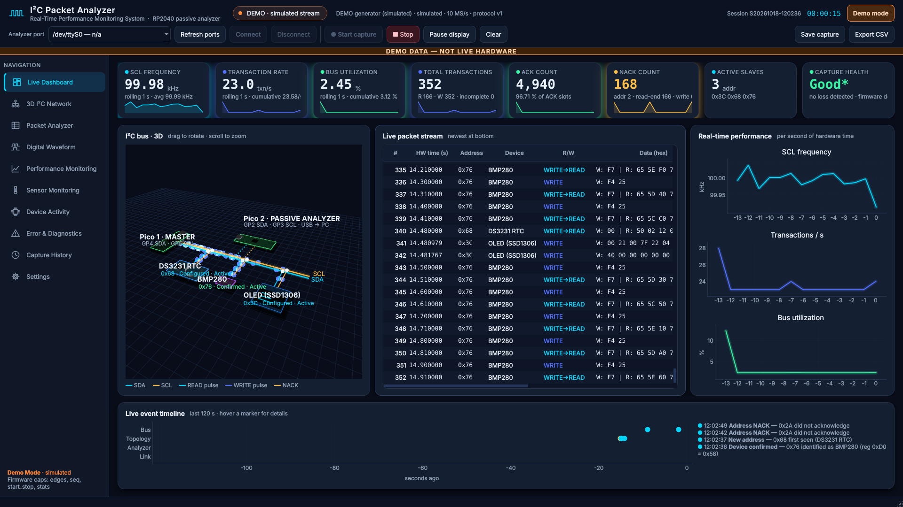

# I²C Packet Analyzer and Real-Time Performance Monitoring System

A PyQt6 desktop application with a 3D bus view, written for a passive RP2040 I²C analyzer.

- **Masters:** Raspberry Pi Pico 1 (Master 1) and Pico 3 / Pico W (Master 2), both SDA GP4, SCL GP5, 100 kHz
- **Slaves:** DS3231 RTC 0x68, BMP280 0x76, SSD1306 OLED 0x3C
- **Analyzer:** Raspberry Pi Pico 2, passive taps on GP2 (SDA) and GP3 (SCL), connected to the laptop over USB
- **Multi-master (2026-11-14):** Master 1 = Pico H (COM32) and Master 2 = Pico W (COM33) share the bus; see **[MULTI_MASTER.md](MULTI_MASTER.md)** for wiring, flashing and the multi-master views



---

## 1. Install on Windows (one time, needs internet)

1. Install **Python 3.10–3.13** from python.org and tick *"Add Python to PATH"*.
2. Open *Command Prompt* in this folder (`i2c_3d_analyzer`) and run:

```bat
python -m venv .venv
.venv\Scripts\activate
pip install -r requirements.txt
```

## 2. Run (fully offline after installation)

```bat
.venv\Scripts\activate
python main.py
```

`python main.py --demo` starts with **Demo Mode** switched on. Demo Mode feeds simulated records through the full decoder, and every screen says **DEMO DATA — NOT LIVE HARDWARE**.

To run the tests: `python -m pytest`. There are 28 tests covering the protocol parser, the decoder, timing metrics, utilisation, gap handling, the BMP280 formula, and save/reload.

## 3. Connect the actual firmware (updated guide)

**Read [CONNECT_REAL_HARDWARE.md](CONNECT_REAL_HARDWARE.md) first.**

The GUI now supports BOTH real firmware formats:

- RP2040 C bundle: `{"type":"hello"}`, `{"type":"segment"}`, `{"type":"loss"}`, `{"type":"status"}` and plain `HELLO`/`START`/`STOP` commands (recommended, included under `firmware/native_rp2040_analyzer/`).
- Original GUI edge protocol: `{"t":"hello"}`, `{"t":"edges"}`, `{"t":"evt"}`, `{"t":"stat"}` and JSON commands.

Optional *Master telemetry* port accepts real BMP280/RTC readings directly from Pico 1, separate from analyzer traffic. The digital waveform viewer remains unavailable when only decoded segments (and no raw edges) are sent.

## 4. Original application documentation

### Legacy raw-edge firmware walkthrough

1. Plug in the analyzer Pico and click **Refresh ports**. Raspberry Pi boards are marked ★. The COM number is never hard-coded.
2. Click **Connect**. The GUI sends `{"cmd":"hello"}`. If the firmware replies, the header shows its firmware name, sample rate and capabilities.
3. Click **Start capture**. *Tip:* start the capture **before** resetting the master Pico. That way the BMP280 calibration read and the OLED initialisation are captured, so temperature/pressure can be computed and the OLED preview is complete.
4. Use **Save capture** to write a `.i2ccap` file. **Capture History** reopens it for offline review, instantly or as a timed playback at 1×, 5× or 20×.

## 4. Pages

| Page | What it shows | Source of every number |
|---|---|---|
| Live Dashboard | 8 metric cards, compact 3D bus, live packet stream, 3 performance graphs, event timeline | decoded transactions and edge timestamps |
| 3D I²C Network | Interactive OpenGL scene: drag to rotate, scroll to zoom, hover for details, click to inspect or filter | nodes appear when an address **ACKs** on the bus, including devices you did not configure |
| Packet Analyzer | Sortable/filterable table, search, bookmarks, copy, CSV, "go to time", byte-level detail (hex/bin/dec/ACK) | decoder |
| Digital Waveform | SDA/SCL square waves, S/Sr/P markers, byte and ACK/NACK annotations, A/B cursors (Δt and 1/Δt), follow-live or per-packet | **raw hardware edge records only** |
| Performance Monitoring | f_SCL min/avg/max, instantaneous and rolling values, t_HIGH/t_LOW, durations, throughput, idle time, gaps, overflows, plus 7 graphs | hardware timestamps |
| Sensor Monitoring | DS3231 clock and date, BMP280 °C and hPa with trends, OLED stats and **framebuffer reconstruction** | bytes decoded from the bus; raw bytes shown alongside |
| Device Activity | 3D view plus per-address table. Clicking a device filters its packets | device registry |
| Error & Diagnostics | Bus events vs analyzer problems vs transport problems, trend graph, explanations | decoder, sequence checker, firmware events |
| Capture History | Save, open, playback, CSV/JSON/statistics export, metadata (sample rate, loss counters, simulated flag) | saved raw records |
| Settings | OLED address, animations, reduced motion, 3D on/off, auto-rotate, refresh rate, captures folder | — |

### Honesty rules built into the code

- **Real Hardware Mode is the default.** With no analyzer connected, nothing is measured, animated or invented.
- The configured 100 kHz is **never** displayed as a measurement. f_SCL comes from SCL rising-edge periods.
- A NACK on the last byte of a READ is counted separately as *read-end (normal)*, not as an error.
- Bus utilisation excludes capture gaps; they are not counted as idle time.
- **Sensor values:**
  - BMP280 values need the calibration words to have been captured. If they were not, the page says why instead of guessing.
  - The DS3231 time is shown only if all 7 BCD registers pass a range check.
  - The OLED preview is labelled *exact* only if both the initialisation and 100 % of the framebuffer were observed with no loss.
- **Device names carry a confidence level:**
  - *Confirmed*: an ID register was observed, e.g. BMP280 register 0xD0 = 0x58.
  - *Configured*: this is how the bench is wired.
  - *Likely*: a common part at that address.
  - *Unknown*: no match.
- Addresses that never ACK (empty-address probes) are listed in the table but are not drawn as devices.
- Light pulses in the 3D view are spawned only from decoded transactions. A legend explains that they are not the electrical waveform.

## 5. Connecting your existing RP2040 analyzer firmware

The GUI needs the analyzer to speak **protocol v1** (see [PROTOCOL.md](PROTOCOL.md)). Your firmware already samples with PIO/DMA and finds transitions, so the change is small:

1. Copy `firmware/i2c_proto_emit.c` and `.h` into the analyzer project.
2. Add the `.c` file to `add_executable()` in its CMakeLists.txt and enable USB stdio (`pico_enable_stdio_usb(<target> 1)`).
3. In your main loop, follow `firmware/analyzer_integration_example.c`:
   - call `proto_poll_command()` regularly,
   - call `proto_capture_begin()` once when capture starts,
   - call `proto_edge(sample_index, sda, scl)` for every sample (it drops non-changes),
   - call `proto_stat()` twice per second,
   - call `proto_event(PROTO_EVT_OVERFLOW, …)` whenever the DMA ring laps the reader.
4. **Remove any other `printf` output** (plain text lines are reported as framing errors), or send it through `proto_log()`.

The timestamp is the **sample index**, so time = index × (1 / sample_hz). The time a line reaches Python is never used.

`i2c_proto_emit.c` compiles and runs on a PC for testing:

```
gcc -DPROTO_HOST_TEST i2c_proto_emit.c -o emit && ./emit
```

Its output passes the Python parser unchanged.

## 6. Features that need analyzer firmware work

| GUI feature | Needs from the analyzer firmware | Status |
|---|---|---|
| Any live decoding, metrics, waveform | `hello` + `edges` records with sample-index timestamps (protocol v1) | **Required now.** Your current text output is not understood. Use `i2c_proto_emit.c`. |
| Correct first packet | Initial line state sent at capture start (`proto_capture_begin`) | Included in the example |
| Loss detection | `seq` on every record + `evt overflow` when the DMA ring overruns | Included. You must call it from your DMA code. |
| "Capture health: Good" (without \*) | Proven lossless capture → announce `lossless` cap | Not yet validated. Leave it out until tested. |
| Saturated bus at 100 kHz | Binary framing or on-chip decoding (`txn` records) to beat the USB bandwidth | Future. The GUI reports the loss meanwhile. |
| Clock-stretching measurement | Nothing extra: stretched periods are excluded from f_SCL automatically | Works |

## 7. Project structure

```
main.py                     entry point
config.py                   colours, addresses, limits
communication/              protocol_parser.py (validation, sequence check), serial_manager.py (QThread reader)
analysis/                   i2c_decoder.py (the ONLY decoder), performance_calculator.py,
                            device_registry.py, sensor_decoder.py (BMP280/DS3231/SSD1306), capture_engine.py
sources/demo_source.py      simulated protocol lines for Demo Mode (labelled everywhere)
models/packet_model.py      Qt table model + filter proxy (no per-cell widgets)
storage/capture_storage.py  .i2ccap save/load, CSV/JSON/statistics export
gui/                        main_window, theme, widgets, icons, network_3d (OpenGL + 2D fallback), one file per page
firmware/                   C protocol emitter + integration template for the RP2040 analyzer
tests/                      pytest suite
```

Data flow: `serial / demo / replay → protocol lines → CaptureEngine → decoder → metrics, registry, sensors → GUI`. The GUI thread only reads results. Serial reception runs on a background thread, and rendering is throttled independently.

## 8. Troubleshooting

- **3D view is black or the window will not open on an old laptop:** in Settings, untick *Use OpenGL 3D* and restart. A 2D topology with the same behaviour is used instead.
- **"No protocol-v1 handshake" banner:** the analyzer firmware is not sending `hello`. See section 5.
- **BMP280 shows "calibration not captured":** keep capturing and press reset on the master Pico.
- **Port missing:** close Thonny, the Arduino IDE or any serial monitor that holds the COM port, then click *Refresh ports*.
